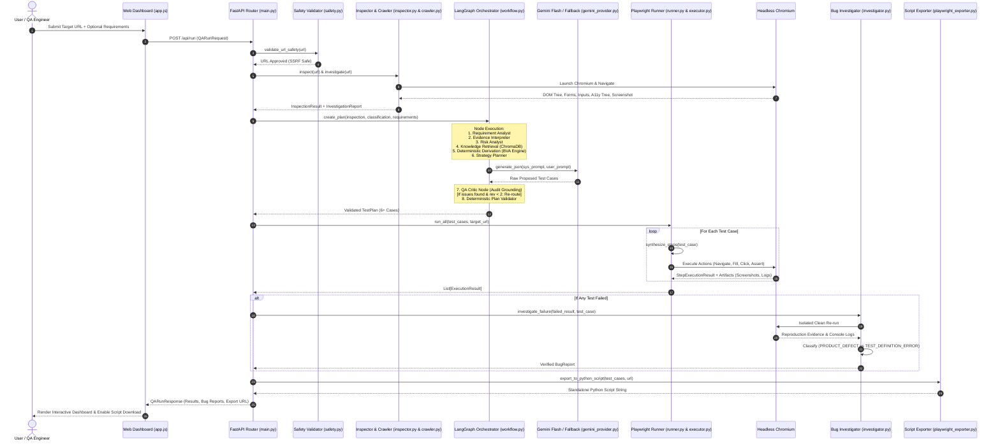
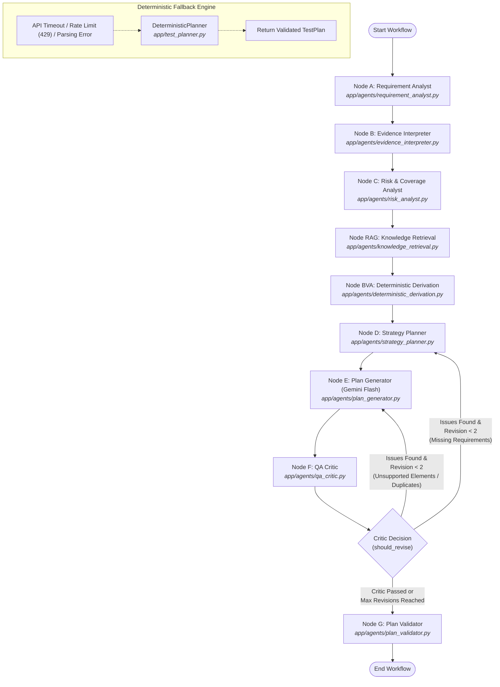

# VerityQA — End-to-End Execution Pipeline

## 1. Overview

This document traces the complete execution lifecycle of VerityQA, starting from a user submitting a target URL on the web dashboard to receiving verified execution results, classified bug reports, and exportable Playwright scripts.

---

## 2. End-to-End System Sequence Diagram

---

## 3. LangGraph Workflow Flowchart

---

## 4. Stage-by-Stage Execution Breakdown

### Stage 1: Request Ingestion & URL Safety
- **Entry Point:** `app/main.py:run_full_qa()` or `app/main.py:inspect_website()`
- **Input:** `QARunRequest(url, description, execute_tests, verify_bugs, export_scripts)`
- **Implementation:** `app/safety.py:validate_url_safety()`
- **Mechanism:** Parses hostname, resolves DNS IP, checks against private ranges (`10.0.0.0/8`, `172.16.0.0/12`, `192.168.0.0/16`, AWS metadata `169.254.169.254`), and validates against `allowed_hosts_list`.
- **Status:** **Fully Implemented & Verified**.

### Stage 2: Browser Inspection & Multi-Page Deep Crawling
- **Entry Point:** `app/inspector.py:WebsiteInspector.inspect()` and `app/investigation/crawler.py:WebsiteCrawler.investigate()`
- **Input:** Target URL string.
- **Implementation:** Launches headless Playwright Chromium. Renders page, waits for network idle, extracts forms, inputs, buttons, headings, links, and accessibility tree, and captures full-page screenshot.
- **Output:** `InspectionResult` and `InvestigationReport` schemas.
- **Status:** **Fully Implemented & Verified**.

### Stage 3: Deterministic Classification
- **Entry Point:** `app/page_classifier.py:PageClassifier.classify()`
- **Input:** `InspectionResult`.
- **Implementation:** Rule-based decision heuristic matching observed password inputs, search inputs, data tables, and link density.
- **Output:** `PageClassification(page_category, confidence, reasoning_summary)`.
- **Status:** **Fully Implemented & Verified**.

### Stage 4: LangGraph Multi-Agent Planning
- **Entry Point:** `app/test_planning_agent.py:TestPlanningAgent.create_plan()`
- **Input:** `InspectionResult`, `PageClassification`, optional user requirements.
- **Nodes Executed in Sequence:**
  1. `RequirementAnalystNode`: Extracts explicit user assertions.
  2. `EvidenceInterpreterNode`: Catalogs interactive targets.
  3. `RiskAnalystNode`: Formulates risk catalog across 5+ dimensions.
  4. `KnowledgeRetrievalNode`: Vector-queries ChromaDB for testing heuristics.
  5. `DeterministicDerivationNode`: Computes BVA boundaries via `BoundaryValueEngine` or derives baseline presence invariants.
  6. `StrategyPlannerNode`: Maps requirements and risks into strategy scenarios.
  7. `PlanGeneratorNode`: Calls Gemini 2.5 Flash with compact JSON schema requesting target test count (default 6).
  8. `QACriticNode`: Verifies DOM grounding, rejecting hallucinated elements.
  9. `PlanValidatorNode`: Pure-Python schema check, sanitizing dangerous tokens and deduplicating cases.
- **Fallback:** If Gemini returns 429 or fails, `DeterministicPlanner` seamlessly produces 6 grounded test cases.
- **Output:** `TestPlan(test_cases, planning_mode, assumptions, review_summary)`.
- **Status:** **Fully Implemented & Verified**.

### Stage 5: Playwright Step Synthesis & Execution
- **Entry Point:** `app/execution/runner.py:QAPlanRunner.run_all()`
- **Input:** `List[TestCase]`, target URL.
- **Implementation:**
  - `synthesize_steps()` maps high-level test cases into concrete `ActionStep` sequences (Navigate, Fill, Click, Assert).
  - Selectors are resolved via `SmartLocator` cascade (`data-testid` $\rightarrow$ semantic ID $\rightarrow$ `aria-label` $\rightarrow$ button text).
  - Executed inside dedicated Playwright page contexts via `app/execution/executor.py:BrowserExecutor`.
- **Output:** `List[ExecutionResult]` with step timings, statuses, and screenshots.
- **Status:** **Fully Implemented & Verified**.

### Stage 6: Defect Investigation & Root Cause Triage
- **Entry Point:** `app/bugs/investigator.py:BugInvestigator.investigate_failure()`
- **Input:** Failed `ExecutionResult` and corresponding `TestCase`.
- **Implementation:**
  - Evaluates objective alignment check: ensures non-positive tests (visibility, masking, validation) are not expecting authentication navigation.
  - Re-executes the failing action in an isolated clean browser context.
  - Inspects browser console error logs and network status codes.
  - Classifies finding into `PRODUCT_DEFECT`, `TEST_DEFINITION_ERROR`, `AUTOMATION_FLAW`, or `ENVIRONMENT_ISSUE`.
- **Output:** `BugReport` with reproduction rate, suspected cause, and suggested fix.
- **Status:** **Fully Implemented & Verified**.

### Stage 7: Reporting, Script Export, & Dashboard Rendering
- **Entry Point:** `app/export/playwright_exporter.py:PlaywrightExporter.export_to_python_script()`
- **Input:** Approved `test_cases`, target URL.
- **Implementation:** Formats Python source code importing `pytest` and `playwright.async_api`, synthesizing self-contained async test functions.
- **Output:** Exportable Python script file downloaded via `/api/run/{run_id}/export`.
- **Status:** **Fully Implemented & Verified**.
