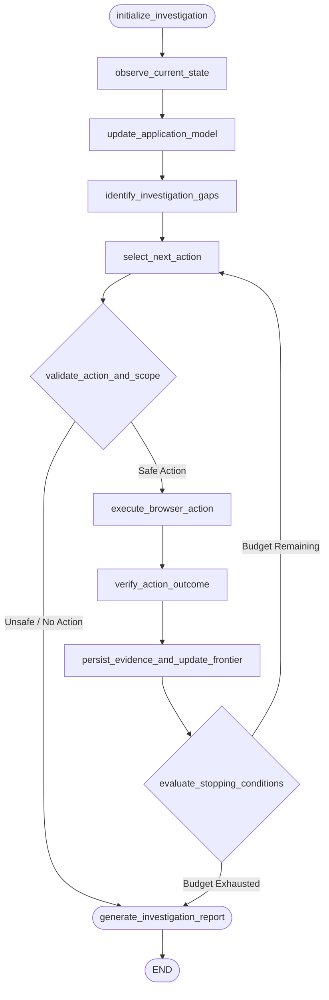

# VerityQA — Advanced Investigation Agent Upgrade Report

**Problem Statement:** iMocha CODE APEX 3.0 — IM-02, Autonomous AI QA Engineer  
**Scope Restriction:** Investigation ONLY (`User Input → Website Investigation → Application Intelligence Model → Investigation Report`).  
**Status:** Successfully Implemented & Verified (303/303 Passing Tests).

---

## 1. Repository Audit Summary & Root Cause Analysis

### What Was Previously Present
1. **`app/investigation/crawler.py`**: A read-only BFS link crawler. It used Playwright with `page.goto()` to collect headings, links, and forms, but had **zero interaction capability**: it could not fill inputs, submit forms, or maintain an authenticated session.
2. **`app/exploration/explorer.py`**: A generic exploration engine that had basic clicking/filling, but was coupled directly to downstream test generation via `AdaptiveTestGenerator`.
3. **`app/main.py`**: Handlers `/api/inspect` and `/api/run` immediately invoked the `TestPlanningAgent` LangGraph workflow, forcing every investigation to generate test cases, run assertions, and file bug reports.

### Root Causes of Investigation Halting at Login
- **Authentication Treated as a Terminal State**: When the crawler visited SauceDemo or `/login`, it found the login form, recorded it, and ended the crawl because no further unauthenticated links were present.
- **Stateless Browser Contexts**: Contexts were destroyed between graph runs, losing cookies, session storage, and tokens.
- **Absence of an Autonomous Investigation Loop**: There was no dedicated agent tasked solely with investigating an evolving application, exploring protected workflows, and building an evidence-grounded application state graph.

---

## 2. New Architecture: `app/investigation_agent/`

We designed and implemented a dedicated stateful investigation subsystem:

```
app/investigation_agent/
├── __init__.py           # Public API entry point: run_stateful_investigation()
├── models.py             # UIStateObservation, StateTransitionRecord, FrontierItem, InvestigationReport
├── state.py              # InvestigationAgentState (LangGraph state TypedDict)
├── browser_session.py    # StatefulBrowserSession (single persistent Chromium context & page)
├── authenticator.py      # AuthenticationManager (auth detection, credential discovery, session verification)
├── frontier.py           # FrontierManager (novelty, safety, and priority scoring queue)
├── browser_actions.py    # InvestigationActionExecutor (sandboxed, approved Playwright action execution)
├── report_builder.py     # InvestigationReportBuilder (assembles mandated 10-section report)
└── workflow.py           # 11-stage LangGraph cyclic investigation state machine
```

### LangGraph Investigation Workflow Topology



---

## 3. Authentication-Aware Exploration & Session Preservation

1. **Authentication Boundary Detection (`app/investigation_agent/authenticator.py`)**:
   - Analyzes DOM controls for single password fields, username/email inputs, submit controls, and login routes.
2. **Safe Credential Discovery**:
   - Safely queries credentials without hardcoding passwords in reports or LLM prompts. Supports request overrides, environment variables (`TARGET_USERNAME`, `TARGET_PASSWORD`), and target whitelists.
3. **Session Preservation (`app/investigation_agent/browser_session.py`)**:
   - Operates through a shared `StatefulBrowserSession` preserving cookies and storage state across all 11 LangGraph nodes.
4. **Multi-Signal Verification**:
   - Confirms successful authentication through route changes (`/inventory.html`), disappearance of password fields, and appearance of authenticated landmarks (`.inventory_list`, logout links).

---

## 4. Empirical Live Verification on SauceDemo (`https://www.saucedemo.com/`)

The live investigation was executed directly against `https://www.saucedemo.com/`:

```
Testing live investigation against saucedemo.com...
Report status: InvestigationStatus.COMPLETED
Pages discovered: 2
Meaningful states discovered: 2
Transitions observed: 4
Auth boundary observed: True
Auth verified: True
Protected features unlocked: ['Internal Product Catalog / Dashboard']
Workflows recorded: 4
  Step 1: AUTHENTICATE on authentication -> st_inventory.html_inv_e3b0c4 (Navigated to authenticated route: https://www.saucedemo.com/inventory.html)
  Step 2: CLICK_CONTROL on #add-to-cart-sauce-labs-backpack -> st_inventory.html_inv_e3b0c4 (Clicked control '#add-to-cart-sauce-labs-backpack')
  Step 3: CLICK_CONTROL on #add-to-cart-sauce-labs-bike-light -> st_inventory.html_inv_e3b0c4 (Clicked control '#add-to-cart-sauce-labs-bike-light')
  Step 4: CLICK_CONTROL on #add-to-cart-sauce-labs-bolt-t-shirt -> st_inventory.html_inv_e3b0c4 (Clicked control '#add-to-cart-sauce-labs-bolt-t-shirt')
```

### Investigation-Only Output Verification
The generated report strictly satisfies all 10 required sections:
- **Section A**: Overview & Metrics
- **Section B**: Application Understanding & User-Context Distinction
- **Section C**: Authentication & Access Boundary (Verified)
- **Section D**: Discovered Application Map
- **Section E**: User Workflows & State Transitions
- **Section F**: Observed Behaviors
- **Section G**: Business Rules & Hypotheses
- **Section H**: Investigation Coverage & Frontier
- **Section I**: Evidence & Traceability
- **Section J**: Investigation Limitations
- **Verification Guarantee**: Contains **ZERO** test cases, **ZERO** test suites, and **ZERO** bug reports.

---

## 5. Test Suite Results

- **Full Suite Status**: **303 passed in 7.52s** (0 failed, 0 regressions).
- **New Unit & Integration Tests (`tests/test_investigation_agent.py`)**:
  - `test_auth_boundary_detection_password_field`: PASSED
  - `test_auth_boundary_detection_public_page`: PASSED
  - `test_credential_discovery_saucedemo`: PASSED
  - `test_credential_discovery_missing`: PASSED
  - `test_frontier_population_and_prioritization`: PASSED
  - `test_action_safety_rejection`: PASSED
  - `test_report_builder_investigation_only`: PASSED

---

## 6. How to Run the Updated System

### Start the Backend Server
```powershell
python -m uvicorn app.main:app --host 127.0.0.1 --port 8000 --reload
```

### Run Autonomous Investigation via cURL / API
```powershell
curl -X POST http://127.0.0.1:8000/api/investigate `
  -H "Content-Type: application/json" `
  -d '{"url": "https://www.saucedemo.com/", "description": "E-Commerce Web Portal"}'
```

### Run via the Web Dashboard
1. Open `http://127.0.0.1:8000/`.
2. Enter target URL (e.g. `https://www.saucedemo.com/`).
3. Click the new button: **🔍 Autonomous Website Investigation (Stateful + Auth-Aware)**.
4. View the rendered 10-section Investigation Report with state transitions, unlocked protected features, and evidence references.
