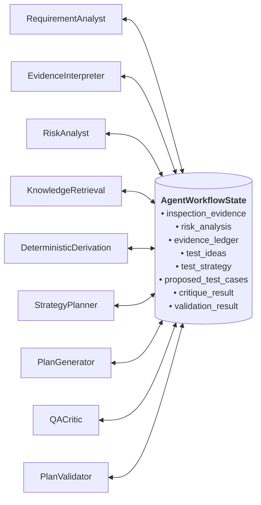

# VerityQA — System Architecture & Agentic Design

## 1. What Makes VerityQA Truly Agentic?

A common pitfall in "AI testing" tools is wrapping an LLM prompt that outputs a script and calling it an "agent". VerityQA is fundamentally different: it is an **observation-driven, cyclic, stateful multi-agent system** governed by strict deterministic guardrails.

### Core Architectural Distinctions:

| Capability | Traditional Scripting / Basic AI | VerityQA Agentic System |
| :--- | :--- | :--- |
| **Observation** | None (reads hardcoded selectors) | Live DOM & Accessibility tree extraction via Playwright. |
| **Planning Logic** | Static 1-shot prompt | Multi-stage LangGraph workflow with separate Risk, Strategy, Generator, Critic, and Validator roles. |
| **Calculation** | AI guesses boundary numbers | Deterministic Python BVA engine ($N-1, N, N+1$) calculating exact inputs. |
| **Review & Audit** | None (accepts all LLM outputs) | Semantic QA Critic enforcing DOM grounding and triggering bounded revision loops. |
| **Failure Triage** | Every fail = "Bug" | Autonomous Failure Investigator re-running steps in clean isolation to classify real defects vs. flaky tests. |

---

## 2. LangGraph State Machine Architecture

The agentic core is built on **LangGraph** (`app/agents/workflow.py`). It coordinates specialized nodes that read from and write to a centralized, strongly typed state object: `AgentWorkflowState`.



---

## 3. Node-by-Node Specification

### Node A: Requirement Analyst (`RequirementAnalystNode`)
- **File:** `app/agents/requirement_analyst.py`
- **Responsibility:** Parses user-supplied testing requirements (plain text). Separates testable functional assertions from untestable or vague desires.
- **Reads:** `state["user_requirements"]`
- **Writes:** `state["requirement_analysis"]` (type: `RequirementAnalysis`)
- **Execution Nature:** Deterministic extraction and structured taxonomy assignment.

### Node B: Evidence Interpreter (`EvidenceInterpreterNode`)
- **File:** `app/agents/evidence_interpreter.py`
- **Responsibility:** Analyzes raw Playwright DOM inspection data. Filters interactive controls, tags form boundaries, identifies input types (text, password, email, submit), and catalogs button labels.
- **Reads:** `state["inspection_evidence"]`
- **Writes:** `state["evidence_analysis"]` (type: `EvidenceAnalysis`)
- **Execution Nature:** Pure deterministic DOM tree processing.

### Node C: Risk & Coverage Analyst (`RiskAnalystNode`)
- **File:** `app/agents/risk_analyst.py`
- **Responsibility:** Formulates a risk catalog prioritized by page classification and observed controls. Covers 5+ core risk areas:
  - Plaintext credential exposure (masking risk)
  - Unhandled empty/blank form submission
  - Incomplete required parameter omission
  - Interactive element accessibility compliance
  - Initial page load integrity and uncaught console exceptions
- **Reads:** `state["page_classification"]`, `state["evidence_analysis"]`, `state["requirement_analysis"]`
- **Writes:** `state["risk_analysis"]` (type: `RiskAnalysis`)
- **Execution Nature:** Deterministic risk catalog generation.

### Node RAG: Knowledge Retrieval (`KnowledgeRetrievalNode`)
- **File:** `app/agents/knowledge_retrieval.py`
- **Responsibility:** Queries local ChromaDB vector store for verified QA testing heuristics matching the page category. Provides optional heuristics for exploratory actions without creating unsupported assertions.
- **Reads:** `state["page_classification"]`, `state["evidence_analysis"]`
- **Writes:** `state["retrieved_patterns"]` (type: `List[QAPattern]`)
- **Execution Nature:** Semantic vector retrieval with in-memory fallback.

### Node BVA: Deterministic Derivation (`DeterministicDerivationNode`)
- **File:** `app/agents/deterministic_derivation.py`
- **Responsibility:** Eliminates LLM calculation hallucinations.
  - If HTML constraints exist (`maxlength`, `minlength`, `min`, `max`, `pattern`, `required`), invokes `BoundaryValueEngine` to compute exact $N-1, N, N+1$ values.
  - If forms lack HTML constraints (e.g. Saucedemo text and password inputs), derives baseline presence invariants (`INVAR-PRESENCE-001`, `INVAR-MASKING-001`, `INVAR-A11Y-001`, `INVAR-LOAD-001`) and records explicit entries in the Unknowns ledger for server-side rules.
- **Reads:** `state["inspection_evidence"]`, `state["investigation_report"]`
- **Writes:** `state["evidence_ledger"]`, `state["test_ideas"]`, `state["unknowns"]`
- **Execution Nature:** Pure deterministic Python computation verified by `OracleVerifier`.

### Node D: Test Strategy Planner (`StrategyPlannerNode`)
- **File:** `app/agents/strategy_planner.py`
- **Responsibility:** Synthesizes risks, requirements, knowledge heuristics, and deterministic test ideas into a concrete, prioritized test strategy.
- **Reads:** `state["risk_analysis"]`, `state["requirement_analysis"]`, `state["test_ideas"]`, `state["retrieved_patterns"]`
- **Writes:** `state["test_strategy"]` (type: `TestStrategy`)
- **Execution Nature:** Deterministic scenario alignment.

### Node E: Test Plan Generator (`PlanGeneratorNode`)
- **File:** `app/agents/plan_generator.py`
- **Responsibility:** LLM-powered test synthesizer. Generates structured JSON test proposals strictly grounded in observed DOM elements, requesting target test count (default 6) covering visibility, masking, negative validation, accessibility, and console integrity.
- **Reads:** Compact JSON context assembled from `state["test_strategy"]`, `state["evidence_ledger"]`, `state["test_ideas"]`, and `state["inspection_evidence"]`.
- **Writes:** `state["proposed_test_cases"]` (type: `List[TestCase]`)
- **Execution Nature:** **LLM-assisted** (Google Gemini 2.5 Flash via `GeminiProvider` or local Ollama).

### Node F: QA Critic (`QACriticNode`)
- **File:** `app/agents/qa_critic.py`
- **Responsibility:** Semantic quality gate and auditor. Inspects proposed test cases against observed DOM evidence:
  - Rejects tests referencing unobserved element selectors or non-existent controls.
  - Flags duplicate or near-duplicate test cases.
  - Verifies that explicit user requirements are adequately addressed.
  - Identifies vague, untestable expected outcomes.
- **Reads:** `state["proposed_test_cases"]`, `state["requirement_analysis"]`, `state["evidence_analysis"]`
- **Writes:** `state["critique_result"]` (type: `CritiqueResult`), `state["revision_count"]`
- **Execution Nature:** Deterministic audit logic driving conditional routing.

### Node G: Deterministic Plan Validator (`PlanValidatorNode`)
- **File:** `app/agents/plan_validator.py`
- **Responsibility:** Final security and schema gate before execution:
  - Enforces `PROPOSED` status across all test cases.
  - Scans action descriptions for dangerous code execution tokens (`exec`, `eval`, `subprocess`, `os.system`).
  - Deduplicates identical test cases by normalized semantic key.
  - Verifies requirement coverage statistics.
  - Truncates test plans exceeding configured maximum limits.
- **Reads:** `state["proposed_test_cases"]`, `state["requirement_analysis"]`
- **Writes:** `state["proposed_test_cases"]` (sanitized), `state["validation_result"]`, `state["workflow_status"]`
- **Execution Nature:** Pure deterministic Python validation.

---

## 4. Conditional Routing & Revision Control

In `app/agents/workflow.py`, the conditional routing edge function `should_revise(state)` governs the feedback loop:

```python
def should_revise(state: AgentWorkflowState) -> str:
    critique = state.get("critique_result")
    rev_count = state.get("revision_count", 0)
    max_revs = state.get("max_revisions", 2)

    if critique and critique.issues_found and rev_count < max_revs:
        state["revision_count"] = rev_count + 1
        if "MISSING_REQUIREMENT" in critique.issue_categories:
            return "strategy_planner"
        return "plan_generator"

    return "plan_validator"
```

### Safety & Termination Guarantees:
1. **Strictly Bounded Cycles:** `max_revisions` is hard-capped at 2. An LLM can never trigger infinite revision loops or exhaust token budgets.
2. **Context-Aware Re-routing:** If a user requirement was missed, the workflow routes back to the `strategy_planner` to adjust priorities; if an unobserved element was hallucinated, it routes directly to `plan_generator` with critique feedback.
3. **Deterministic Fallback Gate:** If revisions hit the ceiling, `PlanValidatorNode` deterministically strips invalid assertions rather than stalling.

---

## 5. Technology Selection Rationale

* **Why LangGraph?** Traditional sequential pipelines (like basic LangChain chains) cannot handle audit-driven feedback loops. LangGraph provides a cyclic, stateful computational graph with typed state, conditional edge routing, and node-level telemetry timing.
* **Why Google Gemini Flash?** Delivers state-of-the-art reasoning at sub-second speeds (50+ tokens/sec) with native structured JSON output enforcement, keeping planning latency under 25 seconds while remaining highly cost-effective.
* **Why Playwright?** Modern websites use dynamic JavaScript, shadow DOMs, and single-page routing (React/Vue/Next.js). Playwright drives real Chromium instances, renders client-side interactions, computes accessibility trees, and provides resilient locator primitives.
* **Why FastAPI & Pydantic v2?** High-performance asynchronous REST endpoints, automatic OpenAPI documentation, and rock-solid runtime data validation preventing schema drift across distributed agent boundaries.
