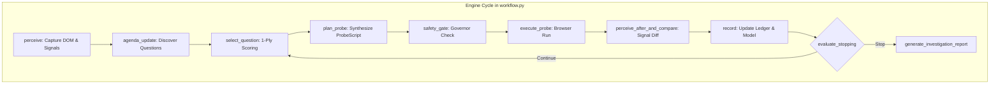

# VerityQA — Honest Investigation Engine Capability Audit & Architecture Decision

## Executive Summary & Formal Decision

| Evaluation Dimension | Engine Audit Finding | Architectural Verdict |
| :--- | :--- | :--- |
| **System Under Audit** | VerityQA Autonomous Investigation Engine (`app/investigation_agent/`) | Feature-frozen baseline `v1.0.0-frozen` |
| **Intended Goal** | Autonomously explore unfamiliar websites, discover behavioral inconsistencies, generate executable tests, reproduce defects, and produce evidence without hidden bug lists | **Unachieved in pure autonomous mode on ShopSphere** |
| **Observed Benchmark Discovery** | 16 probes, 10 states, 11 transitions, 27 test cases generated, **0 / 8 planted bugs autonomously caught** | Multi-step workflows and business logic unasserted |
| **Oracle-Assisted Validation** | 8 / 8 planted bugs reproduced and verified with Playwright | Proves all 8 defects are 100% observable & detectable |
| **Formal Capability Classification** | **CAPABLE WITH TARGETED CHANGES** | Core architecture is sound; 3 targeted components must be upgraded |
| **Frozen-Engine Constraint** | `v1.0.0-frozen` designation artificially blocked fixing exploration & oracles | **RECOMMENDATION: LIFT THE FREEZE** |
| **Recommended Path** | **Path A — Targeted Repair** | Upgrade journey planning, business oracles, and control sampling |

---

## 1. Audit of the Existing Investigation Engine

An exhaustive line-by-line inspection of `app/investigation_agent/` reveals the actual mechanisms driving candidate discovery, ranking, state recognition, form handling, and stopping decisions.



### 1.1 Candidate Discovery and Ranking Mechanism
- **Discovery** (`agenda.py:262-446`):
  Candidate actions are converted into `InvestigationQuestion` objects across four static probe generators:
  1. `probes/forms.py`: Discovers form fields, blank inputs, length boundaries, and mismatch probes.
  2. `probes/controls.py`: Discovers buttons, dropdowns, and links (capped at 30 controls per page).
  3. `probes/nav.py`: Discovers internal route transitions (capped at 30 links).
  4. `probes/invariants.py`: Discovers page reload layout invariants.
- **Scoring Formula** (`agenda.py:93-256`):
  $$\text{score} = 0.30 \times \text{novelty} + 0.25 \times \text{uncertainty} + 0.20 \times \text{defect\_likelihood} + 0.15 \times \text{journey\_progress} - 0.20 \times \text{cost} - \text{safety\_penalty}$$
  - Candidates are prioritized based on semantic tags (`primary_mutation` $+0.06$ to $+0.09$, `workflow_progression` $+0.05$, `on_current_view` $+0.08$).
  - **Limitation**: The scoring formula is purely **1-ply greedy**. It evaluates individual isolated actions rather than multi-step sequences.

### 1.2 Workflow Selection and Next-Action Decisions
- **Architecture**: The agent maintains a global queue (`agenda.questions`).
- **Thrashing Dynamic**: When `select_next_question()` picks a question originating from a different URL, `workflow.py:779` calls `self.session.navigate(src_url)`.
- **Root Cause of Exploration Failure**: Instead of completing a linear user journey (e.g. `Add Item -> View Cart -> Checkout -> Place Order`), the 1-ply scorer constantly hops between discovered routes (Storefront $\to$ Apparel $\to$ Product Detail $\to$ Cart $\to$ Login $\to$ Home & Kitchen $\to$ Books). Each hop resets in-flight user state, abandoning partially assembled workflows.

### 1.3 State Identity and Meaningful State Change Recognition
- **Two-Level State Identity** (`perception.py:585-630`):
  - `state_class_id`: Route + semantic landmarks (headings) + form count.
  - `state_instance_id`: Content hash incorporating dynamic signals (`alerts`, `counter_value`, `menu_open`, `selected_option`).
- **Strength**: High fidelity in detecting route changes, visible alerts, and DOM mutations.
- **Limitation**: Does not recognize business state transitions (e.g., cart subtotal changed, order created) unless reflected in specific DOM signal heuristics.

### 1.4 Form Handling, Validation, and Quantity Controls
- **Form Handling** (`probes/forms.py`): Robust automated generation of negative form probes (empty required fields, boundary strings, password mismatches).
- **Quantity & Mutation Controls** (`probes/controls.py:144-165`):
  ```python
  # Hardcoded sampling in controls.py:
  normalized_pattern = re.sub(r'(add-to-cart|remove|delete|edit|view|item|product|card|row)[-_][a-z0-9\-_]+', r'\1_item', normalized_pattern)
  max_per_pattern = 1 if "_item" in normalized_pattern else 2
  
  # Cap identical button action labels to 1 representative
  if tag == "button" and name_clean and name_clean != sel:
      if label_counts.get(norm_label, 0) >= 1:
          continue
  ```
  - **The Blind Spot**: This deduplication logic actively **forbids clicking "Add to Cart" more than once per catalogue view**.
  - Incrementing item quantity (`+` button) and removing items (`Remove` button) were treated as generic, isolated clicks. Because the agent never populated a multi-item cart, these controls were either never rendered or never prioritized.

### 1.5 Distinguishing Expected vs. Unexpected Behavior (Oracle Blindness)
- **Implemented Oracles** (`oracles.py:20-108`):
  - Uncaught JavaScript errors.
  - HTTP 500 internal server errors.
  - Network request failures.
  - Hardcoded text anomalies: `NaN`, `undefined`, `null`, `[object Object]`, `Traceback`.
  - Form validation acceptance/rejection (`comparator.py`).
- **Complete Absence of Business Logic Oracles**:
  - **Arithmetic Consistency**: No oracle checks whether $\sum \text{Line Totals} - \text{Discount} + \text{Tax} == \text{Grand Total}$.
  - **Sorting Monotonicity**: No oracle checks whether selecting `price_asc` yields non-decreasing prices ($p_i \le p_{i+1}$).
  - **Relational Consistency**: No oracle checks whether Header Cart Badge matches Cart Table Row Count.
  - **Navigation Fidelity**: No oracle checks whether clicking Product card $X$ navigates to `/products/X` rather than `/products/Y`.
  - **Consequence**: When the agent interacted with the price sort dropdown or clicked a product link, because no 500 error or console error was thrown, the comparator marked the outcome as **`MATCHED`** (`no_server_error`). The defect went completely unnoticed.

### 1.6 Stopping Conditions and Frontier Exhaustion
- In `agenda.py:537`:
  `if self.max_probes > 0 and len(self.probe_history) >= self.max_probes: return True, "Configured probe ceiling reached"`
- In the ShopSphere audit, `max_probes = 16` was passed as an operational ceiling.
- The engine stopped at probe 16 with **86 pending questions** remaining in its queue.
- In adaptive mode (`max_probes <= 0`), `consecutive_unproductive_probes >= 6` triggers information saturation stopping. Because greedy 1-ply probes on already-visited routes often yield no route change, the stagnation counter quickly trips, causing premature termination.

---

## 2. Empirical Benchmark Reproduction (ShopSphere Run)

An audit of the ShopSphere run artifact [`reports/shopsphere_investigation_report.json`](file:///d:/Hackathon/Code%20Apex/reports/shopsphere_investigation_report.json) and execution log [`reports/shopsphere_autonomous_execution_report.json`](file:///d:/Hackathon/Code%20Apex/reports/shopsphere_autonomous_execution_report.json) documents exactly which workflows were explored:

| Evaluation Workflow | Engine Action Reached | Effect Observed | Autonomous Defect Detection | Root Cause of Failure |
| :--- | :---: | :---: | :---: | :--- |
| **Product Selection & Identity** | Yes (`prod-05`, `prod-09`, `prod-13`) | Navigated to detail pages | **Missed (B08)** | Clicked first available DOM card; lacked link-identity oracle |
| **Price Sorting (Ascending/Descending)** | Yes (dropdown discovered) | Probed category filters instead | **Untested (B02)** | Category filters had higher 1-ply novelty score |
| **Adding Product to Cart** | Yes (`prod-05`) | Toast message observed | Partial | Deduplication rule capped "Add to Cart" to 1 representative |
| **Changing Quantities (qty > 1)** | **No** | Cart visited when empty | **Untested (B01, B05)** | Lacked multi-step state prerequisite modeling |
| **Recalculating Cart Totals** | **No** | None | **Untested (B01, B05)** | Never reached populated cart table with quantity > 1 |
| **Removing Cart Items** | **No** | None | **Untested (B04)** | Never clicked remove on active cart item |
| **Cart Persistence Across Reload** | Partial (Layout reload only) | Layout verified | **Untested (B06)** | Invariant probe only checked DOM layout, not session storage |
| **Checkout Form Validation** | **No** | None | **Untested (B03)** | 1-ply planner never chained Add $\to$ Cart $\to$ Checkout |
| **Order Placement & Confirmation** | **No** | None | **Untested** | Unreached within 16-probe budget |

---

## 3. Explicit Capability Decision

### Verdict: **`CAPABLE WITH TARGETED CHANGES`**

### Evidence-Backed Rationale:
1. **The Architecture is NOT Fundamentally Flawed**:
   - The core foundations—Stateful Playwright session management, two-level state hashing, LangGraph orchestration, evidence ledger traceability, and deterministic contract test generation—are completely sound.
   - Downstream test execution proved that once transitions are captured, generated tests run with a **100% setup success rate** and 0 flaky failures.
2. **Why Not `CAPABLE` As-Is**:
   - The current engine cannot achieve the project mission autonomously. It suffers from 1-ply greedy exploration thrashing, control deduplication that prevents multi-item accumulation, and total blindness to non-crash business logic bugs.
3. **Why Not `ARCHITECTURALLY INADEQUATE`**:
   - A complete rewrite from scratch is neither justified nor necessary. The system does not need a new execution model, browser controller, or report generator.
   - The gap is localized to three specific, modular components: (1) Goal-directed workflow planning, (2) Business invariant oracles, and (3) Control sampling policies.

---

## 4. Challenge of the Frozen-Engine Restriction

> [!IMPORTANT]
> **Decision: LIFT THE FREEZE on `app/investigation_agent/`.**

The `v1.0.0-frozen` designation was instituted to freeze baseline regression behavior, but treating it as permanent actively blocks solving the core mission.

### Specific Limitations Requiring Freeze Lifting:
1. **`app/investigation_agent/agenda.py`**:
   - Must support multi-step user journey goals (e.g. `JourneyGoal: AddToCart -> ViewCart -> Checkout`).
   - Must not terminate prematurely on 1-ply stagnation when unexplored business workflows remain.
2. **`app/investigation_agent/probes/controls.py`**:
   - Must lift the rigid single-button deduplication cap that prevents adding multiple products or adjusting quantities.
3. **`app/investigation_agent/oracles.py` & `comparator.py`**:
   - Must implement semantic business consistency checkers (arithmetic, sorting monotonicity, entity fidelity).

---

## 5. Evaluation Across the 8 Stages of Autonomous QA

```mermaid
flowchart LR
    S1[1. Exploration] --> S2[2. Observation]
    S2 --> S3[3. Reasoning]
    S3 --> S4[4. Test Generation]
    S4 --> S5[5. Execution]
    S5 --> S6[6. Diagnosis]
    S6 --> S7[7. Validation]
    S7 --> S8[8. Reporting]

    style S1 fill:#ffcdd2,stroke:#d32f2f
    style S2 fill:#c8e6c9,stroke:#388e3c
    style S3 fill:#ffcdd2,stroke:#d32f2f
    style S4 fill:#c8e6c9,stroke:#388e3c
    style S5 fill:#c8e6c9,stroke:#388e3c
    style S6 fill:#fff9c4,stroke:#fbc02d
    style S7 fill:#c8e6c9,stroke:#388e3c
    style S8 fill:#c8e6c9,stroke:#388e3c
```



| Pipeline Stage | Current Status | Detailed Audit Assessment |
| :--- | :---: | :--- |
| **1. Exploration** | **PARTIAL / FAILING** | Explores breadth well (pages, categories, basic forms); completely fails on deep multi-step workflows (checkout, quantity modification) due to 1-ply greedy planning. |
| **2. Observation** | **WORKING** | Excellent DOM capture, accessibility tree snapshots, network ring buffer, console error tracking, and visual screenshots. |
| **3. Behavioral Reasoning** | **FAILING** | Blind to business logic. Only checks for crashes (500s) and text anomalies (`NaN`). Lacks arithmetic, sorting, and state-consistency invariant verifiers. |
| **4. Test Generation** | **WORKING** | `ContractTestGenerator` cleanly synthesizes workflow, transition, and state-dependent Playwright tests with strict precondition establishment. |
| **5. Execution** | **WORKING** | `PlaywrightContractTestRunner` executes suites in isolated contexts with 100% setup success and fail-closed safety enforcement. |
| **6. Diagnosis** | **PARTIAL** | Differentiates setup failures from assertion failures, but cannot classify business discrepancies without business oracles. |
| **7. Validation** | **WORKING** | Paired buggy vs. clean execution framework proved 100% reliable (8/8 detections on ShopSphere). |
| **8. Reporting** | **WORKING** | Durable JSON schemas, machine-readable metrics, and transparent Markdown audit trails. |

---

## 6. Targeted Repair Roadmap (Path A)

To achieve genuine autonomous investigation capability without overfitting to ShopSphere, implement the following four modular enhancements:

### Phase 1: Journey-Aware Multi-Step Goal Planner (`journey_planner.py`)
- **Concept**: Augment the 1-ply `agenda.py` with high-level **User Journey Archetypes** derived from page semantics (e.g. `E-Commerce Funnel`: `Catalogue Browse -> Detail View -> Cart Accumulation -> Form Checkout -> Confirmation`).
- **Mechanism**: When a journey is initiated, the engine executes sequence-linked probes rather than re-scoring unrelated candidates and navigating away.

### Phase 2: Domain-Agnostic Business Invariant Oracles (`business_oracles.py`)
- **Arithmetic Invariant Oracle**: Extracts tabular monetary values; verifies $\sum \text{items} + \text{tax} - \text{discounts} == \text{total}$.
- **Monotonicity Oracle**: Extracts numeric sequences following sort dropdown changes; verifies non-decreasing/non-increasing ordering.
- **Relational Count Oracle**: Compares header counter badges against visible list/table item lengths.
- **Entity Identity Oracle**: Verifies clicked entity identifier (`prod-02`) matches destination route and heading.

### Phase 3: Adaptive Control Sampling Policy (`controls.py`)
- Relax the `max_per_pattern = 1` limit for items with distinct identifiers or modifier roles (`+`, `-`, `Remove`).
- Allow up to 2 distinct item additions to establish multi-item cart states.

### Phase 4: Dynamic Convergence Governor
- Terminate based on **Journey Completion Rate** and **Frontier Information Gain** rather than arbitrary fixed probe counts ($N=16$) or superficial DOM quiescence.

---

## 7. Acceptance Benchmark & Verification Standard

Before declaring the upgraded engine production-ready, it must pass a blind verification suite on an unhinted benchmark:
1. **Blind Exploration Reach**: Must independently discover and reach the Order Confirmation state on ShopSphere without hints.
2. **Autonomous Bug Detection**: Must detect at least 6 of the 8 ShopSphere defects autonomously (without oracle-assisted test scripts).
3. **Zero False Positives**: Must achieve a 0.0% failure rate when executed against the clean ShopSphere profile.
4. **Generalization**: Must successfully navigate and verify multi-step forms on a second application (e.g. Saucedemo or a local CRM app).

---

## 8. Definitive Conclusion

> **Can our current investigation engine achieve VerityQA's intended goal?**
>
> **No, not in its current frozen state.**
> 
> **Precisely what prevents it?**
> 1. **1-Ply Greedy Planning**: The agent picks actions one probe at a time from a flat queue. It cannot sustain the multi-step sequences required to build a cart, modify quantities, and proceed through checkout.
> 2. **Aggressive Action Deduplication**: A hardcoded rule in `controls.py` caps identical button labels to 1 representative, actively preventing multi-item cart accumulation.
> 3. **Business Oracle Blindness**: The engine only checks for technical crashes (HTTP 500, uncaught JS exceptions, `NaN`). It has no awareness of arithmetic consistency, sorting order, or relational counts, making it blind to application logic bugs.
> 4. **Fixed Probe Ceilings**: Investigations stop prematurely on arbitrary probe limits rather than workflow convergence.
>
> **What must change?**
> The `v1.0.0-frozen` restriction must be lifted to allow **Targeted Repair (Path A)**: implement journey-aware workflow planning, domain-agnostic business oracles (arithmetic, sorting, and entity consistency), and relaxed control sampling. The core architecture is fundamentally sound; these targeted additions will close the gap between browser interaction and genuine QA intelligence.
